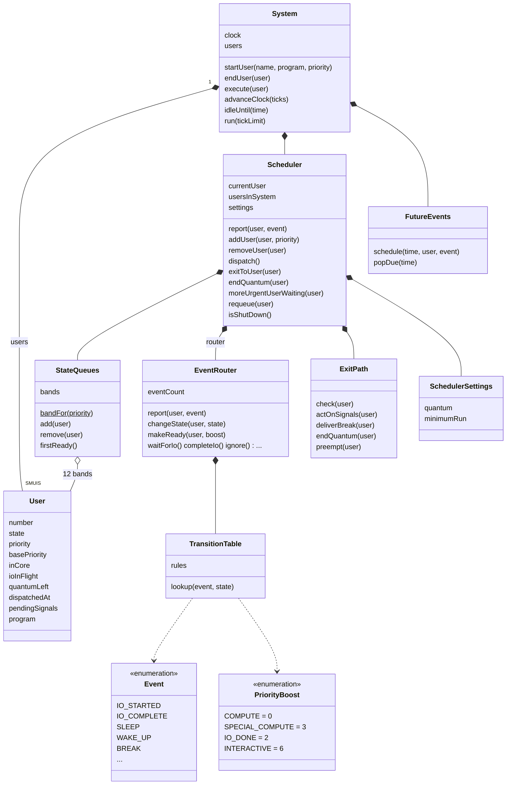
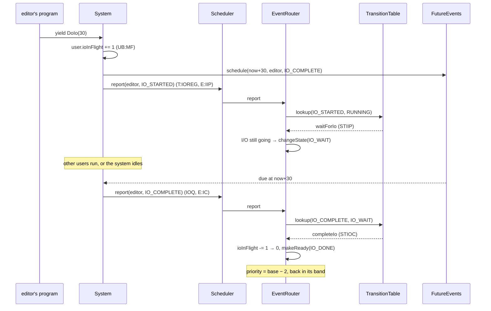
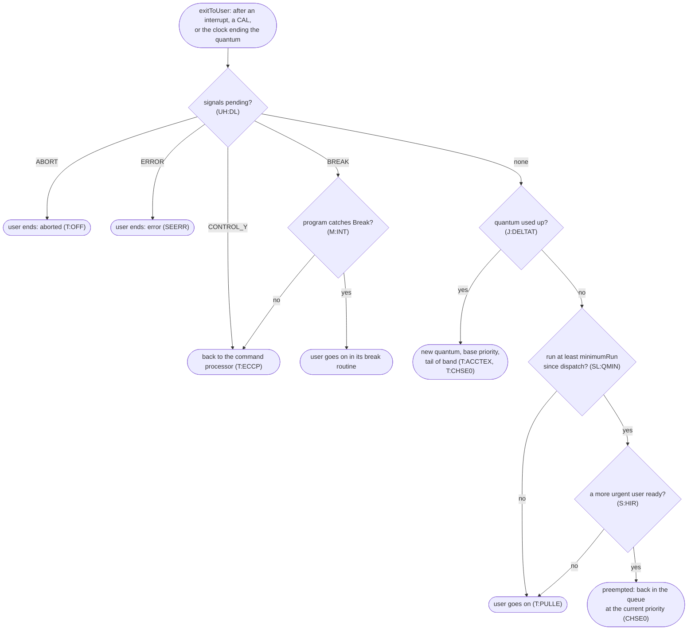
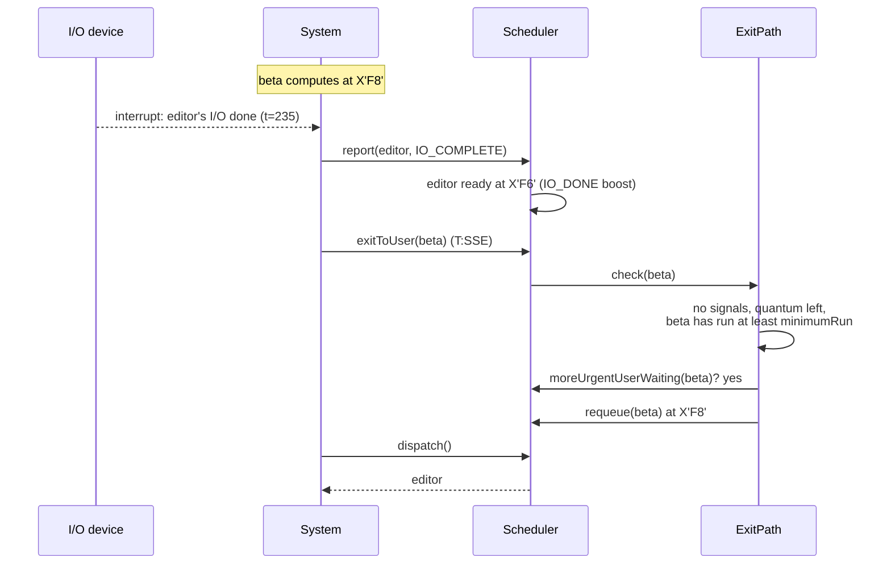
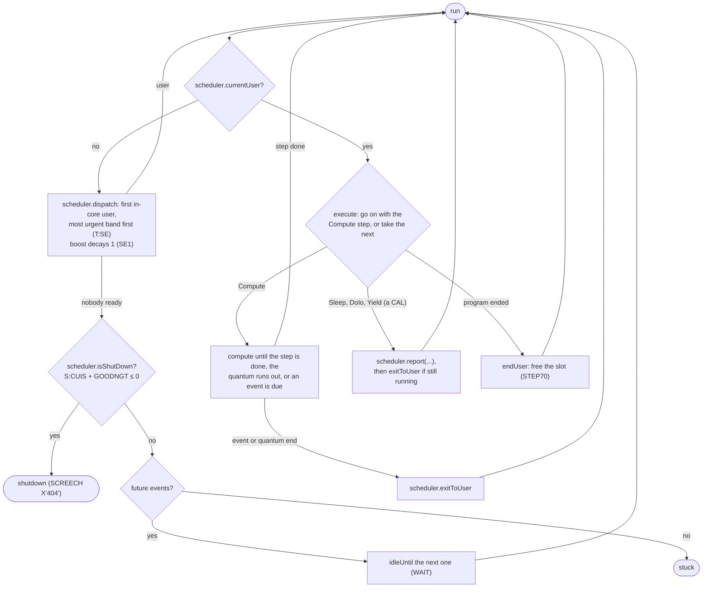

# A readable model of CP-V

`python/cpvmodel/` is a small, runnable model of how CP-V works, with modern names. It is not a
translation. [`uts`](../python/uts) is the faithful translation, which runs the real monitor's
logic down to the registers. The model keeps the design and leaves out the machine. Its job is to
make CP-V easy to follow. Every name in it maps back to the CP-V symbols and source lines it stands
for, in the [glossary](model/glossary.md).

## Conventions

- **Names.**
  - Classes are capitalized nouns (`StateQueues`).
  - Methods are lowercase verbs in camelCase (`dispatch`, `startUser`), and so are attributes
    and test names.
  - Constants and enum members are UPPER_CASE with underscores (`PriorityBoost.INTERACTIVE`,
    `UserState.AWAITING_TERMINAL_INPUT`), so they stand out. If a name never changes after
    import, it's UPPER_CASE.
- **Priority** keeps CP-V's numbers. It runs from X'00' to X'FF', and a **lower value is more
  urgent**. Below X'C0' is real time. On-line and batch users are normally between X'C0' and X'FF'.
- **Simplifications** are stated in each class's docstring as "In CP-V this is really...". Where
  the model follows a CP-V quirk on purpose, the code says `CP-V quirk:`.
- **Independent of `uts`.** The model and its tests never import `uts`.

## Keeping it honest

- **Glossary.** A `cpv(...)` ref ties each class, method, attribute and enum member to CP-V.
  `modelOnly(...)` marks a name with no counterpart. The tests fail when a public name has no
  ref, or when a cited symbol isn't in the cited source lines.
- **The transition table is checked against CP-V's.** A test parses the `ESTS` lines in
  `SCHED.txt` (30 entries, 255 event and state combinations). It checks every one against
  `TransitionTable.lookup`, with the in-core and out-of-core twin states merged as the model
  merges them. It also checks that the model adds no entries CP-V doesn't have.
- **Generated docs.** [`model/glossary.md`](model/glossary.md) and the state diagram in
  [`model/states.md`](model/states.md) are generated from the code. A test fails when they're
  out of date.

## Running it

From `python/`, with the `p3.13` environment:

```
python -m cpvmodel              # a demo run, printed as a trace
python -m cpvmodel docs         # regenerate docs/model/glossary.md and states.md
python -m pytest cpvmodel/tests # or: make modeltest
```

## The model so far

The model is built from **components**, one per major part of CP-V. Each component is a
subpackage with one class in front. The rest of the system calls that class's methods, never
its parts.

| Package | Front class | CP-V | Parts |
|---|---|---|---|
| `cpvmodel.scheduler` | `Scheduler` | SCHED, "execution and swap scheduler" | `StateQueues`, `EventRouter` and `TransitionTable`, `ExitPath`, `SchedulerSettings`; later `SwapScheduler` |
| `cpvmodel.filesystem` (later) | `FileSystem` | the file management modules | directories, file kinds, `GranuleAllocator` |

`System` (`cpvmodel/system.py`) puts the components together. It owns what's machine-wide: the
user slots, the clock, `FutureEvents`, the run loop and the trace. `User` and the program steps
are shared by everything.



A program is a generator that yields `Compute(ticks)`, `Sleep(ticks)`, `DoIo(ticks)` or
`Yield()`. Each stands for what a user's code does in CP-V: compute, or make a CAL that leads
to an event report. A tick is a clock-4 tick, 2 ms. A program can catch `Break`; that is its
break routine (`M:INT`).

### Events and the transition table

When something happens to a user, it is **reported** as an event: `scheduler.report(user, event)`.
The transition table looks up the user's state and the event and returns an action:

- a **state**: just move there (`SLEEP` from `RUNNING` → `ASLEEP`);
- a **priority boost**: make the user ready, that much more urgent than their base
  (`WAKE_UP` from `ASLEEP` → ready with `SPECIAL_COMPUTE`, 3);
- a **handler**, an `EventRouter` method, for anything more involved (`IO_STARTED` →
  `waitForIo`, which waits only if the I/O isn't already done).

An event that doesn't apply to the user's state is `InconsistentEvent`, CP-V's `SCREECH X'02'`.
Many events are deliberately harmless in most states: `WAKE_UP` for a user who isn't asleep is
ignored. The transitions that later iterations will model are in the table already. They raise
`NotModelledYet`: signals, terminals, access queues, kick-out, shared processors and too much
I/O. All the moves are in the [state diagram](model/states.md).

An I/O round trip:



### The exit path

Every interrupt, trap and CAL goes back to the user through the **exit path** (`SSE0`–`SSE6`).
That is where CP-V acts on signals, ends quanta and preempts. `scheduler.exitToUser(user)`
runs it:



Signals are reported like any other event. For a running or I/O-waiting user, `BREAK`,
`CONTROL_Y`, `ERROR` and `ABORT` only set a flag (`STBEEA`). The user acts on it the next time
they run. A user who is asleep, waiting for terminal input, or ready is also made ready with
the interactive boost (`STBEEAC`), so they see the signal soon.

A preemption, from the demo:



### The run loop

In CP-V, `T:SE` is entered again after every quantum, block and interrupt exit. Here it is a
plain loop:



### What it shows

From the demo (`python -m cpvmodel`), with a quantum of 100 ticks. `editor` alternates
computing and I/O, `clock` sleeps, and `alpha` and `beta` crunch at the same base, X'F8':

```
   100  alpha      quantum ended
   100  beta       dispatched at 0xf3
   ...
   225  beta       dispatched at 0xf8
   235  editor     IO_COMPLETE: IO_WAIT -> READY
   235  beta       preempted
   235  editor     dispatched at 0xf7
```

- The crunchers' 120-tick programs are cut into quanta, and they take turns at each quantum end.
- When `editor`'s I/O ends at 235, its I/O boost makes it X'F6', more urgent than `beta` at
  X'F8'. `beta` has run more than the minimum, so it is preempted at the interrupt.
- A newcomer's boost can outrank an I/O boost. A cruncher still at X'F3' isn't preempted by an
  editor at X'F6' (`testANewcomersBoostCanOutrankAnIoBoost`).
- `clock` wakes with the special-compute boost. But its base is X'FC', so X'FC' − 3 = X'F9' is
  still less urgent than the crunchers.

What is CP-V's so far:

- **Bands, order and dispatch.** Priority bands are from `CHSE1`. A user goes behind equal
  priorities (`T:CHSE`). Dispatch takes the first in-core user, most urgent band first (`T:SE`).
- **Priority over time.**
  - A new user starts with the interactive boost (`ADD1` → `STIRC`).
  - An event that makes a user ready gives the `SH:PINC` boost for that kind of event.
  - The boost decays by 1 at each dispatch (`SE1`, `S:PRIODEC`).
  - At quantum end the user goes back to their base, at the tail of the queue (`T:CHSE0`).
  - A preempted user keeps their current priority (`CHSE0`).
  - A real-time user always runs at their base ("DONT FLOAT RT").
- **Events.** CP-V's whole state-and-event table, checked against the source.
- **The exit path.** Signals are acted on in CP-V's order of importance, and all four are
  cleared at once, so a break that comes with a control-Y is lost. Then quantum end, the
  minimum run and preemption.
- **Shutdown.** When nobody is ready and `usersInSystem − ghostsKeptAtShutdown ≤ 0`, the run
  ends ("shutdown"). This is the idle check, `S:CUIS`+`GOODNGT` ≤ 0, which ends in
  `SCREECH X'404'`.

Not yet:

- No swapping, so every user stays in core. That also leaves out the swap quantum
  (`SL:SQUAN`, `SL:SQNT`, `SL:SQPB`).
- No DO list and no command processor. Control-Y and an uncaught break end the user instead
  of returning to TEL.

## Iterations

1. **A shallow System** (done). Users, bands, dispatch, priority boost and decay, shutdown.
2. **Events and the transition table** (done). `Event`, `TransitionTable`,
   `InconsistentEvent`, `EventRouter`, `FutureEvents`. Programs that sleep, do I/O and yield.
   The generated state diagram. Then the refactor into components: `Scheduler` in front of
   SCHED's parts, with `System` putting the components together.
3. **The exit path** (done). `ExitPath`, `SchedulerSettings` and `Signal`. Quanta cut by the
   clock, preemption at interrupts after the minimum run, and signals, with `Break` thrown
   into programs.
4. **Resources.** Blocking on and releasing `R:*` resources, and their events.
5. **Swapping.** `inCore`, pages, the swap scheduler choosing who comes in and who goes out,
   kick-out, and the swap quantum.
6. **Terminals and log-on.** Terminal read and output blocking, and log-on from a break.
