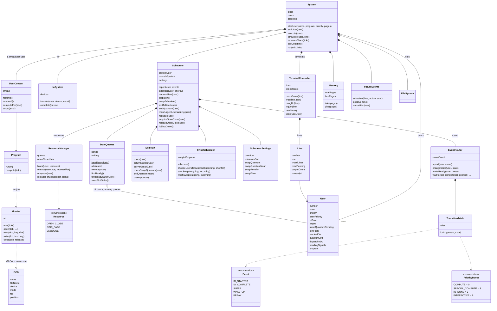
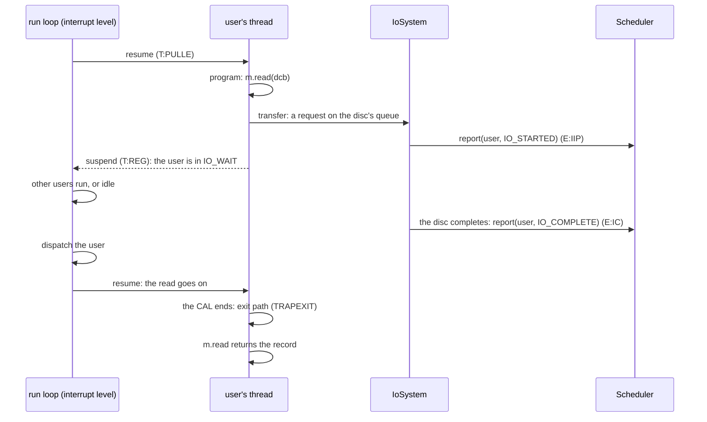
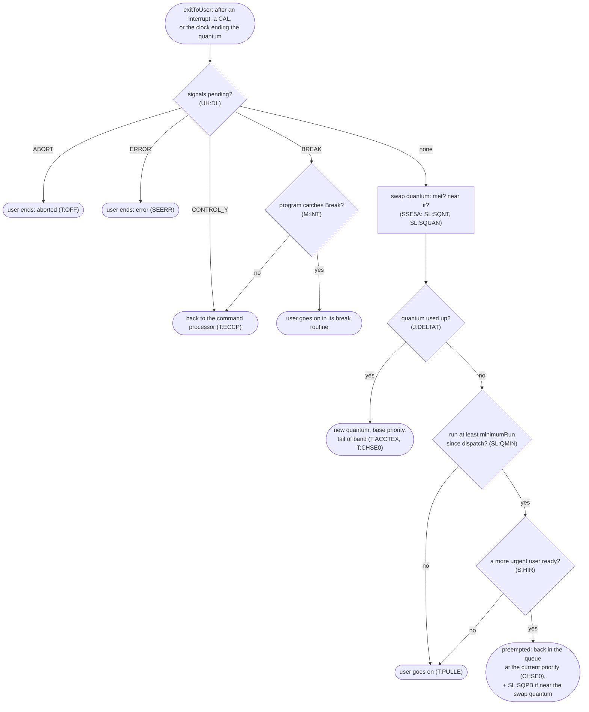
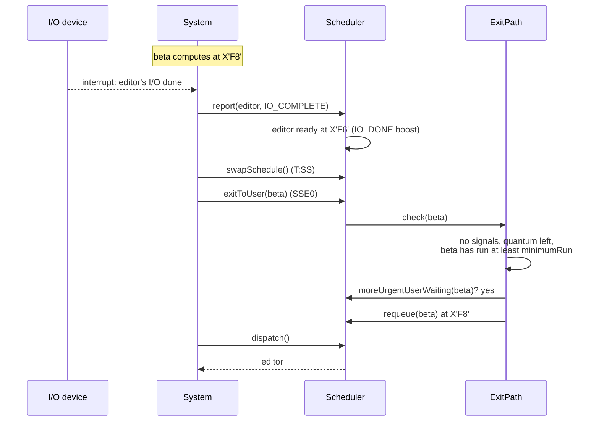
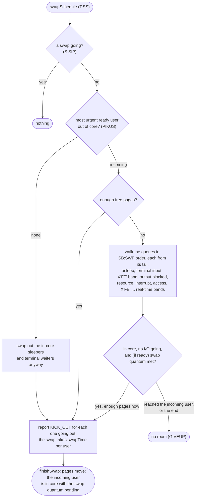
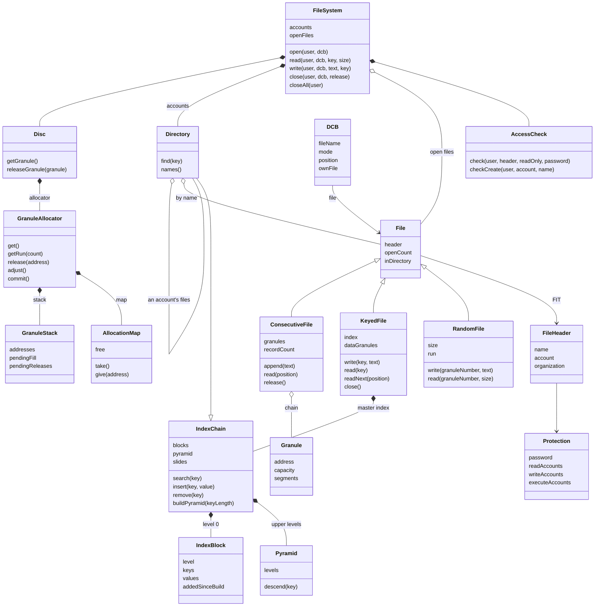
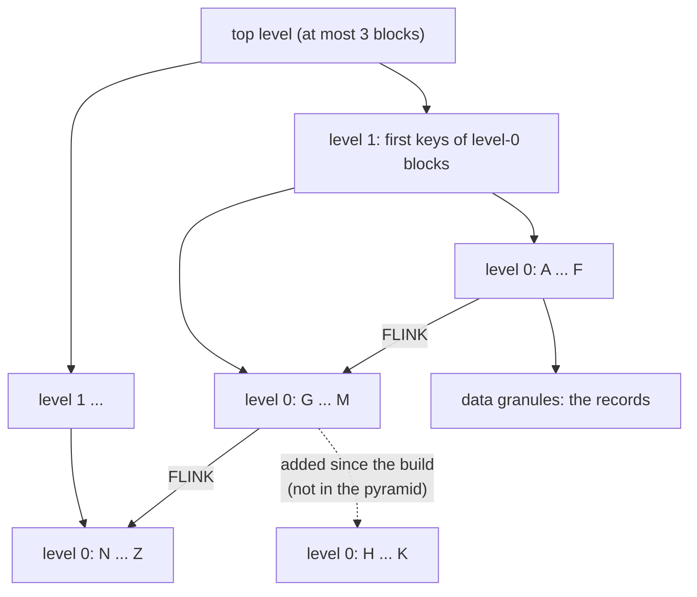
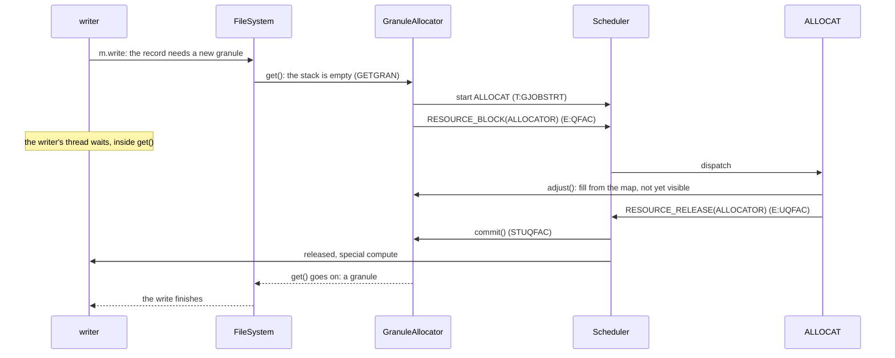
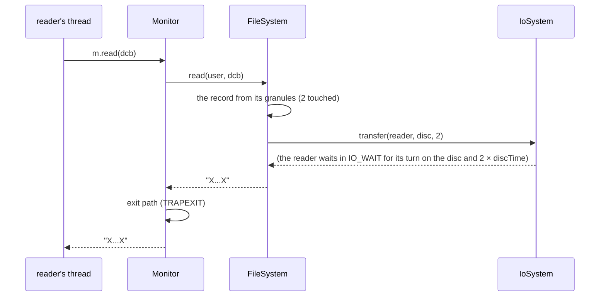
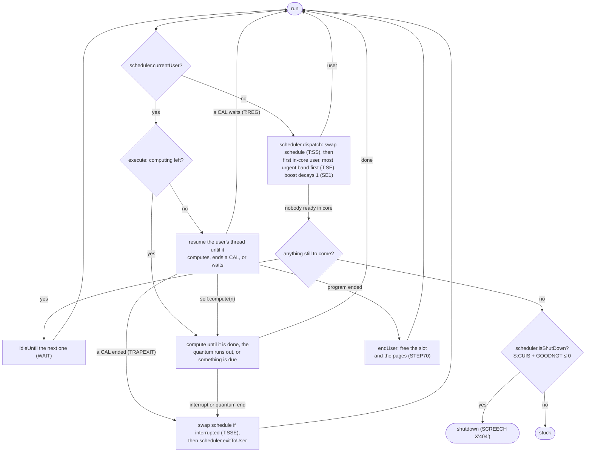

# A readable model of CP-V

`python/cpvmodel/` is a small, runnable model of how CP-V works, with modern names. It is not a
translation. [`uts`](../python/uts) is the faithful translation, which runs the real monitor's
logic down to the registers. The model keeps the design and leaves out the machine. Its job is to
make CP-V easy to follow. Every name in it maps back to the CP-V symbols and source lines it stands
for, in the [glossary](model/glossary.md).

## Conventions

- **Names.**
  - Classes are capitalized nouns (`StateQueues`).
  - Methods are lowercase verbs in camelCase (`dispatch`, `startUser`), and so are attributes
    and test names.
  - Constants and enum members are UPPER_CASE with underscores (`PriorityBoost.INTERACTIVE`,
    `UserState.AWAITING_TERMINAL_INPUT`), so they stand out. If a name never changes after
    import, it's UPPER_CASE.
  - A CP-V term every CP-V programmer knew keeps its capitals as a class name: `DCB`.
- **Priority** keeps CP-V's numbers. It runs from X'00' to X'FF', and a **lower value is more
  urgent**. Below X'C0' is real time. On-line and batch users are normally between X'C0' and X'FF'.
- **Simplifications** are stated in each class's docstring as "In CP-V this is really...". Where
  the model follows a CP-V quirk on purpose, the code says `CP-V quirk:`.
- **Independent of `uts`.** The model and its tests never import `uts`.

## Keeping it honest

- **Glossary.** A `cpv(...)` ref ties each class, method, attribute and enum member to CP-V.
  `modelOnly(...)` marks a name with no counterpart. The tests fail when a public name has no
  ref, or when a cited symbol isn't in the cited source lines.
- **The transition table is checked against CP-V's.** A test parses the `ESTS` and `RESOURCE`
  lines in `SCHED.txt` (44 entries, 437 event and state combinations). It checks every one against
  `TransitionTable.lookup`, with the in-core and out-of-core twin states merged as the model
  merges them. It also checks that the model adds no entries CP-V doesn't have.
- **Generated docs.** [`model/glossary.md`](model/glossary.md) and the state diagram in
  [`model/states.md`](model/states.md) are generated from the code. A test fails when they're
  out of date.

## Running it

From `python/`, with the `p3.13` environment:

```
python -m cpvmodel              # a demo run, printed as a trace
python -m cpvmodel terminal     # a user logs on at a terminal, beside a cruncher
python -m cpvmodel docs         # regenerate docs/model/glossary.md and states.md
python -m pytest cpvmodel/tests # or: make modeltest
```

## The model so far

The model is built from **components**, one per major part of CP-V. Each component is a
subpackage with one class in front. The rest of the system calls that class's methods, never
its parts.

| Package | Front class | CP-V | Parts |
|---|---|---|---|
| `cpvmodel` (the core) | `System` | the machine, and a user's context | `Program`, `Monitor` (the CALs), `UserContext` (a user's thread), `DCB`, `User`, `Memory`, `FutureEvents` |
| `cpvmodel.iosystem` | `IoSystem` | IOQ, the I/O queues | `Device`, `IoRequest` |
| `cpvmodel.scheduler` | `Scheduler` | SCHED, "execution and swap scheduler" | `StateQueues`, `EventRouter` and `TransitionTable`, `ExitPath`, `SwapScheduler`, `ResourceManager`, `SchedulerSettings` |
| `cpvmodel.terminals` | `TerminalController` | COC, "character-oriented communications" | `Line`, `TerminalSettings`; `EchoSession`, a `Program`, stands in for TEL |
| `cpvmodel.filesystem` | `FileSystem` | OPNF, CLS, RDF, WRTF: the file management modules | `Disc`, `GranuleAllocator` (with `AllocationMap`, `GranuleStack`, the ALLOCAT ghost), `IndexChain` (with `IndexBlock`, `Pyramid`), `Directory`, `FileHeader`, `File`, `ConsecutiveFile`, `KeyedFile`, `RandomFile`, `AccessCheck`, `Protection`, `FileSystemSettings` |

`System` (`cpvmodel/system.py`) puts the components together. It owns what's machine-wide: the
user slots, `Memory`, the clock, `FutureEvents`, the users' threads, the run loop and the trace.
The components talk to each other only through their front classes: the terminals report
events to the scheduler with `scheduler.report`. Programs reach the components through the
`Monitor`'s CALs.



### Programs, the Monitor and DCBs

A user's program is a class with `run(self, m)`. `m` is the **`Monitor`**, whose methods are the
CALs: CP-V's `M:READ` with its FPT is `m.read(dcb, ...)`. A program declares its **DCBs**, and
every I/O CAL names one:

```python
class Editor(Program):
    def __init__(self):
        self.data = DCB("F:DATA", fileName="DATA")

    def run(self, m):
        m.open(self.data, mode=FileMode.IN)
        while (text := m.read(self.data)) is not None:
            m.write(m.uc, text)                  # M:UC: the user's terminal
            self.compute(5)
        m.close(self.data)
```

- **The CALs** are `m.wait(ticks)` (`M:WAIT`), `m.open(dcb, ...)`, `m.read(dcb, key, size)`,
  `m.write(dcb, text, key)` and `m.close(dcb, release)`. `m.open`'s arguments override what the
  DCB was set up with, as an FPT's parameters do.
- **A DCB is assigned** to a file (`fileName`), to the terminal (`m.uc`, which is `M:UC`), or to
  another device (`device`). `m.read` and `m.write` go where it is assigned: the file system,
  the terminal controller, or the device's queue.
- **Computing isn't a CAL.** It is the program's own `self.compute(ticks)`. A tick is a clock-4
  tick, 2 ms.
- **Errors and breaks are exceptions.** A file error is a `FileError` raised from the CAL; a
  break is a `Break` raised wherever the program was suspended, and catching it is the
  program's break routine (`M:INT`). An uncaught one ends the user.

### Users as threads

Each user's program, and the monitor code serving their CALs, runs in the user's own Python
thread (`UserContext`), but **only one thread runs at a time**:

- **The run loop** is CP-V's interrupt level and execution scheduler. It dispatches a user and
  resumes their thread (`T:PULLE`), then waits.
- **The user's thread** runs until the program computes, a CAL ends or waits, or the program
  ends. Then it hands control back and waits to be resumed (`T:REG`, the environment saved in
  the JIT).
- **A CAL waits where CP-V waits:** for the disc, the terminal, the open/close lock, granules,
  or ALLOCAT's answer. The service reports the event (the user leaves `RUNNING`) and suspends;
  when the user runs again, the service goes on from there.
- **Every CAL ends through the exit path** (`TRAPEXIT`), which may act on a signal or preempt
  the user.

So a program never sees any of it: to it, `m.read` just took a while. Python's threads are only
places to wait; the model's scheduler decides who runs, and a run is the same every time.



### Events and the transition table

When something happens to a user, it is **reported** as an event: `scheduler.report(user, event)`.
The transition table looks up the user's state and the event and returns an action:

- a **state**: just move there (`SLEEP` from `RUNNING` → `ASLEEP`);
- a **priority boost**: make the user ready, that much more urgent than their base
  (`WAKE_UP` from `ASLEEP` → ready with `SPECIAL_COMPUTE`, 3);
- a **handler**, an `EventRouter` method, for anything more involved (`IO_STARTED` →
  `waitForIo`, which waits only if the I/O isn't already done).

An event that doesn't apply to the user's state is `InconsistentEvent`, CP-V's `SCREECH X'02'`.
Many events are deliberately harmless in most states: `WAKE_UP` for a user who isn't asleep is
ignored. Two transitions in the table aren't modelled and raise `NotModelledYet`: too much I/O
(`STIOMF`) and associating a shared processor (`STASP`). All the moves are in the
[state diagram](model/states.md).

An I/O round trip, a tape read of 30 ticks:

```mermaid
sequenceDiagram
    participant P as editor's thread
    participant I as IoSystem
    participant C as Scheduler
    participant R as EventRouter
    participant T as TransitionTable
    P->>I: m.read(tape): transfer
    I->>I: ioInFlight += 1 (UB:MF), request on the tape's queue
    I->>C: report(editor, IO_STARTED)  (T:IOREG, E:IIP)
    C->>R: report
    R->>T: lookup(IO_STARTED, RUNNING)
    T-->>R: waitForIo (STIIP)
    R->>R: I/O still going → changeState(IO_WAIT)
    Note over P: the editor's thread waits; others run, or the system idles
    I->>C: the tape completes: report(editor, IO_COMPLETE)  (REQCOM, E:IC)
    C->>R: report
    R->>T: lookup(IO_COMPLETE, IO_WAIT)
    T-->>R: completeIo (STIOC)
    R->>R: ioInFlight -= 1 → 0, makeReady(IO_DONE)
    Note over R: priority = base − 2, back in its band
```

### The exit path

Every interrupt, trap and CAL goes back to the user through the **exit path** (`SSE0`–`SSE6`).
That is where CP-V acts on signals, ends quanta and preempts. `scheduler.exitToUser(user)`
runs it:



Signals are reported like any other event. For a running or I/O-waiting user, `BREAK`,
`CONTROL_Y`, `ERROR` and `ABORT` only set a flag (`STBEEA`). The user acts on it the next time
they run. A user who is asleep, waiting for terminal input, or ready is also made ready with
the interactive boost (`STBEEAC`), so they see the signal soon.

A preemption: an I/O completion makes a more urgent user ready.



### Swapping

Users need pages in core to run, and there are fewer pages than users need, so the
**swap scheduler** (`T:SS`) decides who is in core. It runs before every dispatch and on every
interrupt exit. A new user starts out of core, and is swapped in before they first run.



Some consequences, all CP-V's:

- **Only waiting users and less urgent ready users can be swapped out** for a user coming in.
  The walk starts with the least urgent band and stops when it reaches the user coming in.
- **A just-swapped-in ready user is protected** until they've run the swap quantum
  (`SL:SQUAN`) in a quantum, so swapping can't thrash. CP-V only looks at the swap quantum once
  the user has used `SL:SQNT` (300 ms), so in effect it is never shorter than that.
- **Nobody is swapped out while I/O is going**, and the running user is in no queue, so it is
  never a candidate either.
- **When nobody needs to come in, sleepers and terminal waiters are swapped out anyway**, so
  the room is there when someone does.
- **A user preempted when nearly through the swap quantum goes back 2 notches less urgent**
  (`SL:SQPB`, commented "BOOST TWO NOTCHES" but added to the priority value).

A swap, from the demo:

```mermaid
sequenceDiagram
    participant S as System
    participant C as Scheduler
    participant W as SwapScheduler
    participant Q as StateQueues
    participant M as Memory
    Note over S: alpha's quantum ends (t=515)
    S->>C: dispatch()  (T:SE)
    C->>W: schedule()  (T:SS)
    W->>Q: firstReadyOutOfCore()
    Q-->>W: clock, needs 4 pages; 3 free
    W->>Q: swapOutOrder()
    W->>W: alpha: ready, in core, swap quantum met
    W->>C: report(alpha, KICK_OUT)  (E:KO: inCore = false)
    Note over W: swap device busy for 2 × swapTime
    C-->>S: editor (in core) runs meanwhile
    W->>M: give(alpha's 5), take(clock's 4)  (t=535)
    W->>W: clock in core, swap quantum pending
```

### Resources

When something a user needs is short (a disc page, a terminal buffer, a symbiont file slot),
the monitor **blocks** them on that resource: the user waits in `AWAITING_RESOURCE`. When it
comes free, the resource is **released** and waiting users are made ready with the
special-compute boost. Each resource has its own release rule (`SH:RFLG`):

| Resource | CP-V | Release |
|---|---|---|
| `SYMBIONT_FILE_SLOT` | `R:SYMF` | everyone (FLUSH) |
| `SYMBIONT_DISC_SPACE` | `R:SYMD` | everyone |
| `OPEN_CLOSE` | `R:OCR` | one user, and only if nobody is the open/close user (`OPNUNBLOCK`) |
| `TERMINAL_BUFFER` | `R:CBA` | everyone |
| `DISC_PAGE` | `E:ND`/`E:DPA` | everyone |
| `ALLOCATOR` | `E:QFAC`/`E:UQFAC` | everyone, after updating ALLOCAT's buffers (not modelled) |
| `ENQUEUE` | `R:NQW` | only the user the release is reported for (SPECIFIC); a signal also releases |

Open/close is a lock built from a resource. Only one user at a time may open or close files
(`OPNCLSUS`). `m.open` and `m.close` take it as CLS and OPNF do (`acquireOpenClose`): if
someone else is the open/close user, the user blocks on `OPEN_CLOSE` and tries again when
released. At the end the lock is given up and, if anyone is waiting, the release is reported
(`E:NOCR`, from IORT).

```mermaid
sequenceDiagram
    participant A as a (open/close user)
    participant C as Scheduler
    participant R as ResourceManager
    participant B as b, c (blocked)
    Note over A: a holds the open/close
    B->>C: acquireOpenClose: someone else has it
    C->>R: block(b), then block(c)  (head of the queue)
    A->>C: releaseOpenClose(a)
    C->>R: release(OPEN_CLOSE)  (E:NOCR)
    R->>R: OPNUNBLOCK: nobody holds it, c becomes the open/close user
    R->>C: makeReady(c, SPECIAL_COMPUTE)
    Note over B: c runs, claims again (it's c's), opens; b waits for c
```

Two CP-V quirks show here:

- **Last in, first out.** Blocking pushes the user on the *head* of the resource's queue
  (`T:RES`), and release takes the head (`T:REL`). In `testOpenCloseWaitersAreReleasedLastInFirstOut`,
  `c` blocks after `b` but gets in first.
- **The released user is usually more urgent than the releaser.** With the special-compute
  boost, `c` preempts `a` on `a`'s way back from the CAL that released it.

A signal for a blocked user is only noted, and acted on when they next run, after the
release. The exception is `ENQUEUE`, whose flags list the signals (`SETDL`): there the user
is released at once to act on the signal.

### Terminals and log-on

The **terminal controller** (CP-V's COC) owns the terminal lines and reports what happens on
them to the scheduler:

| On the line | The model | Event, state |
|---|---|---|
| A program reads, nothing typed yet | `read` (`COCRD`) | `TERMINAL_READ` (`E:CRD`): `AWAITING_TERMINAL_INPUT` (`STI`) |
| A line is typed, a read waiting | `type` (`COCIP`) | `TERMINAL_INPUT_DONE` (`E:CIC`): ready, interactive boost (`STIRC`) |
| A line is typed, no read yet | `type` | kept as type-ahead; the next read takes it without waiting |
| A write with `SL:TB` characters still to go out | `write` (`COCWR`) | `OUTPUT_BLOCKED` (`E:CBL`, `STOB`) |
| The output drains to `SL:UB` | `outputDrained` (`COCOP`) | `OUTPUT_UNBLOCKED` (`E:CUB`): ready, I/O-done boost |
| Break on a line with a user | `pressBreak` | `BREAK` (`E:CBK`) |
| Break on a line with nobody | `pressBreak` → `logOn` (`LOGON`) | a new user, through `ADD1` |
| The line drops | `hangUp` | `ABORT` (`E:OFF`) |

**Log-on** (`LOGON`, `SCHED.txt:1869`) takes a free slot if the on-line users are under
`S:OUAIS`. It ties the user to the line (`LB:UN`) and starts them at the on-line priority
`SL:OPRIO`. In CP-V the user starts in TEL, the command processor; the model runs the line's
`session`, by default an echo loop that stops at `OFF`. When the user ends, the line is free
again and the on-line count drops (`STEP.txt:159`).

**Input that beats the block.** COC reports the read (`E:CRD`) after finding no input. If the
input completes in between, `E:CIC` arrives while the user is still running. `STIRCU` then
remembers it (`UH:FLG` X'4000'), and `STCRD` lets the read go straight on. The access queue
(`STQA`, `STUQA`) uses the same flag.

From the terminal demo (`python -m cpvmodel terminal`), a user typing beside a cruncher:

```
    20  line0      logged on, line 0
    20  line0      TERMINAL_READ: RUNNING -> AWAITING_TERMINAL_INPUT
    20  line0      KICK_OUT in AWAITING_TERMINAL_INPUT
   ...
   300  line0      TERMINAL_INPUT_DONE: AWAITING_TERMINAL_INPUT -> READY
   300  line0      swapped in
   300  cruncher   preempted
   300  line0      dispatched at 0xf3
```

- While the user waits for input they are swapped out, because nobody else needs to come in.
- Each typed line brings them back with the interactive boost (X'F2'), ahead of the cruncher.
- At 700 the cruncher is preempted 190 ticks into its quantum, near its swap quantum, so it goes
  back at X'FA' rather than X'F8' (`SL:SQPB`).

### The file system

The file system is the third component. Its front class is `FileSystem` (CP-V's OPNF, CLS, RDF
and WRTF, about 25,000 lines). So far it has:



- **Two levels of directory.** The account directory maps an account to its file directory,
  which maps a file name to the file. Both are **index chains** (below), searched along their
  blocks from the first, so an account with many files is slower to open from. In CP-V each
  directory is also kept in a second copy, which the model leaves out.
- **A consecutive file** is a chain of granules of 2048 bytes. The header (the FIT, the closest
  modern idea is an inode) takes 320 bytes of the first. Records follow one another, each with
  a 4-byte control word, and a record that doesn't fit is split into segments continued in the
  next granule.
- **A keyed file** keeps its records under keys. Its **master index** is an index chain of
  key → where the record is; its first block shares the first granule with the header. The
  records go into data granules, packed one after another and split across granules when
  they don't fit. A program reads by key, or in key order.
- **A random file** is a run of contiguous granules, fixed when it is created, read and written
  by granule number. Its header has a granule of its own. The run is a request to ALLOCAT
  (`GNBG`), found from the end of the map, so the open waits on `ALLOCATOR` while ALLOCAT
  answers, then goes on. A transfer starts at a granule and goes on through the next ones,
  and the position moves past them. A granule number past the end is X'42'; a write that
  runs off the end moves what fits and is X'44'.
- **Open** first looks among the open files, so a second reader shares the `File` and reads no
  directories. Each program has its own `DCB`, with its own position. In
  CP-V an open file's state is a separate table in core, the CFU, which exists only while the
  file is open. The model's files are in memory anyway, so that state is on the `File`:
  `openCount` and `inDirectory`. **A file opened OUT is new**: it goes into its directory only at close,
  replacing any file of the same name and releasing its granules. Until then, opening the name
  IN finds the old file, or nothing.
- **Who may open a file** (`SECCHK`). A file's `Protection` is set when it is created: a
  password, and lists of read, write and execute accounts (each may also hold `ALL` or `NONE`).
  OPEN checks, in order:
  1. Privilege X'C0' opens anything.
  2. A password must match; an empty one is for the `:SYS` account only.
  3. The owner opens the file for anything, and so does a write account.
  4. Anyone else may only read: anyone at all if there are no read or execute accounts, else
     the read accounts.
  5. Execute access, through a processor, isn't modelled.

  A refusal is X'14'. Creating a file in another account needs privilege X'C0' (`OP71`), and a
  random file can't replace a keyed or consecutive one, nor the other way round.
- **Deleting** is closing with release (`m.close(dcb, release=True)`, CLOSE's REL). Nothing
  is deleted while someone else has the file open, or when the user isn't its owner (or as good
  as) and lacks privilege X'C0'; that is an ordinary close. A new file opened OUT isn't in the
  directory yet, so releasing it discards it and the old file stays. A deleted file's entry is
  slid out of its directory (`DEL1`), and its granules go back: a random file's run as a
  message to ALLOCAT (`RNBG`).
- **Open and close take the open/close lock** (`OPNCLSUS`), the resource from the scheduler,
  and hold it while they wait for the disc. A second user opening at the same time blocks on
  `OPEN_CLOSE`.
- **Disc time.** Every granule read or written, and every index or directory block searched, is
  a disc access of `discTime` ticks. The accesses go as a transfer on the **disc's queue**
  (`IoSystem`), and the program waits in `IO_WAIT` as for any I/O. One disc serves one request
  at a time, so users reading at once take turns. `discTime` is 0 by default.

**Index chains.** The account directory, the file directories and every keyed file's master
index are the same structure, `IndexChain`:

- **Blocks.** Entries are in key order, in a chain of index blocks, each a granule. An entry's
  size depends on the chain: 18 bytes in the account directory, 41 in a file directory, the key
  slot plus 13 in a master index.
- **Search** walks the chain from the first block, one disc access a block, until a block's
  keys reach the key.
- **Insert** slides the following entries down. Every block keeps `spare` bytes free (102 in a
  keyed file); the block with the header has 320 bytes less. **When a block is full** its last
  entry moves to the front of the next block, or to a new block chained in after it. Each new
  block counts a **slide**.
- **The pyramid.** At close, a keyed file that has chained in more than `rebuildAfterSlides`
  new blocks (254 by default) gets its upper levels rebuilt (`MUL`). Level 1 holds the first
  key of each level-0 block, and each level is built from the one below until one has at most
  three blocks. A search then goes down a few levels: 1000 keys written in order make a chain
  of 14 blocks, and finding the last takes 14 accesses without a pyramid and 2 with one.
- **The pyramid restriction.** While a pyramid exists, a block it points at must keep its first
  key, so a key that would go in front of it goes at the end of the block before (`MULCHK`).



**Granule allocation.** Granules come from three levels:

```
file code ── get / release ──► the stack (GranuleStack)      quick: a list of free addresses
                                  ▲   │
              fill to 80 ◄────────┘   └────► empty to 40       done by the ALLOCAT ghost
                                  │   ▼
                               the map (AllocationMap)        a bit per granule, 1 = free
```

- **Get** pops the stack, and **release** pushes on it. With the stack full (128), a released
  granule waits for ALLOCAT instead.
- **The thresholds.** A get or release that leaves 16 or fewer on the stack, or 100 or more,
  **starts ALLOCAT**. ALLOCAT is a user like any other, scheduled by the scheduler.
- **ALLOCAT** fills a low stack up to 80 from the map, or empties a high one down to 40 into
  it, and gives the waiting releases back to the map. Its fill isn't usable yet: when it is done
  it reports `E:UQFAC`, and the scheduler's release routine for `ALLOCATOR` (`STUQFAC`)
  **commits** the fill.
- **A user who finds the stack empty waits, where they are** (`GETGRAN`, "CANT SWITCH - LETS
  REG HIM"). ALLOCAT is started, and the user blocks on the `ALLOCATOR` resource (`E:QFAC`)
  in the middle of whatever they were doing: a write, an index insert, a directory entry. When
  the commit releases them, the operation goes on from there. Monitor work outside any user
  takes from the map directly.
- **The map** is searched from where the last search stopped. Releasing a granule that is
  already free is a **dual allocation**, which is logged.



In CP-V there is a stack per device type and a map per device, ALLOCAT is started at boot and
sleeps between runs, and `E:UQFAC` comes from the swapper when it takes ALLOCAT out of
core. The model has one stack and one map, starts ALLOCAT when it is needed, and has it report
`E:UQFAC` as it ends.

A read, through the components:



### The run loop

In CP-V, `T:SE` is entered again after every quantum, block and interrupt exit. Here it is a
plain loop, in the loop's own thread; the users' threads run only when it resumes them:



### What it shows

From the demo (`python -m cpvmodel`). It has 12 pages of memory, swaps of 10 ticks per user, and
a 500 ms quantum. `alpha` and `beta` (5 pages each) crunch at base X'F8', `editor` (4 pages)
alternates computing and I/O, and `clock` (4 pages, base X'FC') sleeps:

```
   270  beta       quantum ended
   270  beta       KICK_OUT in READY
   270  -          swap starts: out beta; in editor
   270  alpha      dispatched at 0xf4
   290  beta       swapped out
   290  editor     swapped in
   290  alpha      preempted
   290  editor     dispatched at 0xf3
   ...
   535  clock      dispatched at 0xf7
   535  clock      SLEEP: RUNNING -> ASLEEP
   535  clock      KICK_OUT in ASLEEP
   535  -          swap starts: out clock; in beta
```

- `editor` and `clock` start out of core and wait for room. At 270 `beta`'s quantum ends. It
  has met its swap quantum, so it goes out to make room for `editor`, and `alpha` runs during
  the swap.
- When `editor` is in core it preempts `alpha`, being more urgent on its newcomer boost.
- At 535 `clock` goes to sleep and is swapped out at once to bring `beta` back.
- When `clock` wakes at 635 it is ready at X'F9', less urgent than the crunchers at X'F8'. The
  walk reaches `clock` before them, so there is no room until a cruncher ends.
- At the end, with nobody waiting to come in, the sleeping `clock` is swapped out anyway and
  swapped back in when it wakes.

What is CP-V's so far:

- **Bands, order and dispatch.** Priority bands are from `CHSE1`. A user goes behind equal
  priorities (`T:CHSE`). Dispatch takes the first in-core user, most urgent band first (`T:SE`).
- **Priority over time.**
  - A new user starts with the interactive boost (`ADD1` → `STIRC`).
  - An event that makes a user ready gives the `SH:PINC` boost for that kind of event.
  - The boost decays by 1 at each dispatch (`SE1`, `S:PRIODEC`).
  - At quantum end the user goes back to their base, at the tail of the queue (`T:CHSE0`).
  - A preempted user keeps their current priority (`CHSE0`).
  - A real-time user always runs at their base ("DONT FLOAT RT"). CP-V quirk: the test is on
    the *boosted* priority, so a background user with a base of X'C0' to X'C5' whose boost goes
    below X'C0' is queued in the real-time band, at its base (ALLOCAT, at X'C0', showed this).
- **Events.** CP-V's whole state-and-event table, checked against the source.
- **The exit path.** Signals are acted on in CP-V's order of importance, and all four are
  cleared at once, so a break that comes with a control-Y is lost. Then the swap quantum,
  quantum end, the minimum run and preemption.
- **Swapping.** Who comes in, the swap-out walk in `SB:SWP` order with its exclusions, the
  swap quantum, swapping out idle waiters, and kick-out (`STKO`, `STKOT`).
- **Resources.** The seven resources with their release flags, last in first out, the
  open/close lock (`OPNCLSUS`, `OPNUNBLOCK`), and signals releasing ENQ waiters.
- **Terminals and log-on.** Reads, type-ahead, output pacing, break, hang-up and log-on, with
  the "input before the block" flag.
- **Shutdown.** When nobody is ready and `usersInSystem − ghostsKeptAtShutdown ≤ 0`, the run
  ends ("shutdown"). This is the idle check, `S:CUIS`+`GOODNGT` ≤ 0, which ends in
  `SCREECH X'404'`. CP-V's system ghosts keep that count up until a `ZAP`. The model has no
  ghosts, so it also waits for anything still to come, such as a log-on.

Not yet:

- **Swapping detail.** Pages are only counted: no shared processors (their use counts and
  pages), no page stealer, no locks in core. A failed swap-in is retried at every schedule;
  CP-V waits until the swap set changes (`S:SEVF`).
- **Resource detail.** ALLOCAT's buffers (`STUQFAC`) aren't modelled, and nothing in the
  model is short of disc pages, buffers or symbiont space yet. The tests stand in for the
  monitor code that blocks on them.
- **Terminal detail.** COC's characters, echo, editing and line modes; the model types and
  reads whole lines. TEL is stood in for by `EchoSession`.
- **Still `NotModelledYet`:** too much I/O (`STIOMF`) and associating a shared processor
  (`STASP`).
- No DO list and no command processor. Control-Y and an uncaught break end the user instead
  of returning to TEL.

## Iterations

The names in the iterations below are those of their time. Until the refactor at the end,
programs were generators that yielded request objects (`Compute`, `DoIo`, `ReadRecord`, ...).

### The scheduler

1. **A shallow System** (done). Users, bands, dispatch, priority boost and decay, shutdown.
2. **Events and the transition table** (done). `Event`, `TransitionTable`,
   `InconsistentEvent`, `EventRouter`, `FutureEvents`. Programs that sleep, do I/O and yield.
   The generated state diagram. Then the refactor into components: `Scheduler` in front of
   SCHED's parts, with `System` putting the components together.
3. **The exit path** (done). `ExitPath`, `SchedulerSettings` and `Signal`. Quanta cut by the
   clock, preemption at interrupts after the minimum run, and signals, with `Break` thrown
   into programs.
4. **Swapping** (done). `Memory`, `SwapScheduler`, waiting-state queues in `StateQueues`,
   kick-out, the swap quantum, and swap time.
5. **Resources** (done). `Resource`, `ResourceManager`, the resource events, and `WaitFor`,
   `Release` and `OpenClose` in programs.
6. **Terminals and log-on** (done). `TerminalController`, `Line`, `TerminalSettings`, and
   `ReadTerminal` and `WriteTerminal` in programs. Log-on from a break, hang-up, and the access
   queue.

### The file system

1. **A shallow file system** (done). `FileSystem`, `Directory`, `Disc`, consecutive files,
   open and close (IN and OUT) under the open/close lock, open files shared, a
   new file entered at close, disc time, and `Open`, `ReadRecord`, `WriteRecord` and `Close` in
   programs.
2. **Index chains and keyed files** (done). `IndexChain`, `IndexBlock`, `Pyramid`, `KeyedFile`,
   and the directories as index chains. Insert with the room rule, moving the last entry,
   slides, the pyramid at close and its restriction. Reads by key and in key order.
3. **Granule allocation** (done). `GranuleAllocator`, `GranuleStack`, `AllocationMap`, and the
   ALLOCAT ghost. Users wait on `ALLOCATOR` (`E:QFAC`) until ALLOCAT's fill is committed
   (`E:UQFAC`, `STUQFAC`). A full disc is a `FileError`.
4. **Random files, deleting files, and OPEN's access checks** (done). `RandomFile`,
   `AccessCheck` and `Protection`, user privilege, and `Close(handle, release=True)`.

Not modelled in the file system: opening UPDATE, INOUT or OUTIN; synonyms; expiration dates;
execute access through a processor; private packs; the directories' dual copies; and FIX1,
the start-up check and repair of every file.

### The refactor: threads, the Monitor and DCBs

Programs as generators yielding request objects mixed user CALs with monitor internals, put
every service's details into `System`, and needed a retry mechanism because a service couldn't
wait halfway. So (after a spike):

- a user's program and their CALs run in the user's thread (`UserContext`), with only one thread
  running at a time;
- a program is a `Program` class with `run(self, m)`, and its CALs are the `Monitor`'s methods;
- every I/O CAL names a `DCB` (replacing `FileHandle`), and devices serve requests from queues
  (`IoSystem`);
- the services moved into their components and wait where CP-V waits; the retry mechanism,
  the up-front granule check and the request objects are gone.

Behaviour didn't change: both demos give the same traces. Users now take turns on the disc.

### Possible next components

- **Load modules and FETCH.** A `LoadModule` would be the stored form of a program: a keyed file
  with a header (`HEAD`), an overlay tree (`TREE`), and each segment's data, procedure and DCB
  sections. FETCH (`!RUN`) reads it into a user's memory and makes it a running `Program`. The
  DCB table it sets up (`J:DCBLINK`) would let the model check, as CP-V does, that a CAL names one
  of the program's own DCBs (otherwise X'AF', "ILLEGAL-DCB"). See `docs/loadmodule.md`.
- **Recovery.**

