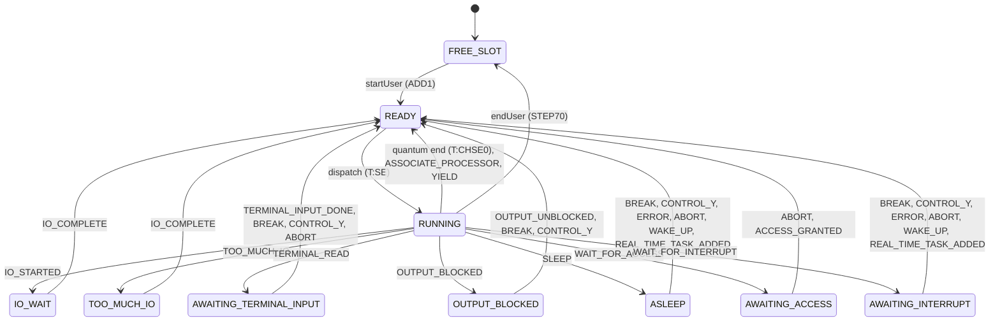

# User states

Generated by `python -m cpvmodel docs` from the transition table
(`cpvmodel/events.py`) and the event router. Don't edit by hand.

Each arrow is a move a user can make, labelled with the events (UPPER_CASE) or
the other steps that cause it. Events that leave the state as it is, such as
a break for a running user (it only sets a flag) or a kick-out (it only clears
`inCore`), have no arrow.

